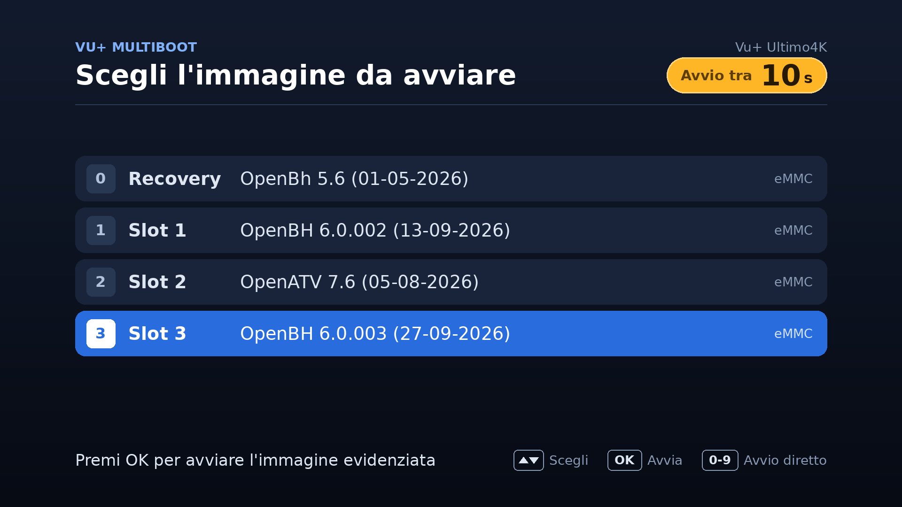

# MultiBootStartupMenu

A startup menu for the Vu+ kexec MultiBoot: at every power-on the receiver
shows the list of the installed images and starts the one chosen with the
remote control, like the old OpenMultiboot menu did.



It changes neither the image nor any kernel. It uses two things the Vu+ kexec
MultiBoot already provides: the `initrd=` option that the 1st stage
(`kernel_auto.bin`) reads from `/STARTUP`, and `STARTUP_ONCE`, which starts a
slot exactly once. The menu itself runs from the Recovery, before any image is
started.

- **Tested on:** Vu+ Ultimo 4K, Solo 4K, Duo 4K SE.
- **Everywhere else:** the plugin appears wherever the boot partition has the
  layout it needs (`STARTUP`, `STARTUP_RECOVERY`, `STARTUP.cpio.gz`, `zImage`),
  whatever the make of the receiver — but it says that nobody has tested it
  there and does nothing until you accept that. **Try it with YELLOW first:**
  that loads the menu at the next start only and leaves `/boot/STARTUP` alone
  (see *Trying it on an untested receiver* below). Nothing in the plugin
  depends on the model, so adding one to the tested list is one line in
  `SUPPORTED_MODELS` plus your report.
- **Images:** OpenBH 5.6 and 6.0.x, OpenATV 7.x. Any image with the kexec
  MultiBoot and Python 3.
- **Requires:** a Recovery image in the boot partition (the stock one), and
  PIL (`python3-pillow`), which the images above already have.

## Install

Copy the `.ipk` to the receiver and, in **one slot you actually use**:

```sh
opkg install enigma2-plugin-systemplugins-multibootstartupmenu_<version>_all.ipk
```

Restart the GUI, then **Menu → Standby & Restart → MultiBoot startup menu setup**,
set *Show the boot menu at startup* to yes and press **GREEN**. It prepares
the files, checks them and only then changes `/boot/STARTUP`; it then offers to
restart so you can see the menu.

The menu itself needs the plugin in no slot at all — it lives in the boot
partition. Installing it in **every** slot you boot is still recommended: in a
slot that has it, changing slot from the MultiBoot image selector, from the
image manager or from OpenWebif writes `STARTUP_ONCE` instead of overwriting
`/boot/STARTUP`, so the menu survives; and if another image did overwrite
`/boot/STARTUP`, the first slot with the plugin puts it back. Do **not**
install it in the Recovery: that is the way out when something goes wrong, and
it should stay as it is.

## Using the menu

| Key | What it does |
| --- | --- |
| ▲ ▼ | move through the list |
| OK | start the highlighted image |
| 0 – 9 | start that slot directly (0 is the Recovery) |
| any key | stops the countdown |

If no key is pressed, the highlighted image starts when the countdown on the
title line runs out. If that image cannot be started, the **Recovery** starts —
not the next slot, which with the same skin could be mistaken for the image you
asked for.

## Settings

| Setting | |
| --- | --- |
| Show the boot menu at startup | turns the whole thing on and off |
| Automatic start after | 3 to 30 seconds |
| Default image | the entry highlighted when the menu appears; *Last started image* follows your last choice |
| Show the Recovery in the menu | whether the Recovery is listed (it stays the fall-back either way) |
| BLUE | preview of the menu, full screen |
| YELLOW | load the menu at the next start only, without changing `/boot/STARTUP` |

## Trying it on an untested receiver

The menu uses nothing specific to a model, so it may well work on a receiver
nobody has tried it on. Finding out costs one boot:

1. Before installing anything, over SSH:

   ```sh
   mbsm-report          # with the package installed
   sh mbsm-report.sh    # or from tools/, without installing
   ```

   It only reads. The last lines say whether the boot partition has the layout
   the menu works with.

2. Install the package, open the plugin and press **YELLOW** (*Try once*). It
   writes the menu to `STARTUP_ONCE`, which the kexec stage boots exactly once;
   `/boot/STARTUP` is not touched. Restart.

3. One of three things happens. The menu appears, you choose an image, and the
   receiver goes back to starting that image directly — it works. The menu does
   not appear and the receiver starts as usual — it does not, and nothing was
   changed. Or you get a black screen: switch off and on again, and the receiver
   starts as usual, because `STARTUP_ONCE` is consumed by that boot whatever
   happens.

4. At the next start the plugin says which of the three it was. Send that,
   plus the output of `mbsm-report` and `/boot/bootmenu/bootmenu.log` if there
   is one, and the model can go in the tested list.

Make a backup of the slots you care about first, and only go on if you know how
to reflash your receiver. This is a test: it is not expected to brick anything —
every failure path starts an image instead — but no one has run it there yet.

## If something goes wrong

1. **Black screen or the menu does not appear.** Switch off and on again. One
   failed run starts the default image once; two in a row restore `/boot/STARTUP`
   and turn the menu off by themselves.
2. **The receiver reaches no image at all.** Put a USB stick with a file named
   `STARTUP_RECOVERY` in it and switch on: the Recovery starts. From there use
   the MultiBoot image selector to pick a slot, then **remove the stick**.
3. **By hand, over SSH, from any slot or from the Recovery** (replace 3 with
   the slot you want):

   ```sh
   cp /boot/STARTUP_3 /boot/STARTUP
   sed -i 's/^ENABLED=1/ENABLED=0/' /boot/bootmenu/bootmenu.conf
   ```

4. **Removing it.** Turn the menu off from the plugin, or just remove the
   package: while the menu is active, removing it restores `/boot/STARTUP` to
   the running slot first. Do not delete `/boot/bootmenu` while the menu is
   active — `/boot/STARTUP` would point at an initrd that is no longer there.

## Translations

The source strings are English. Catalogues live in [`po/`](po/), one file per
language, and are compiled into the plugin when the package is built.

To add a language, copy `po/MultiBootStartupMenu.pot` to `po/<code>.po`, fill
in the `msgstr` lines and run:

```sh
python3 tools/i18n.py
```

Pull requests with a new or corrected `po/<code>.po` are welcome — that file is
all that is needed.

Currently: English, Italian.

## Building and testing

```sh
python3 tools/build_ipk.py dist     # builds the .ipk (compiles the catalogues first)
python3 tools/i18n.py               # catalogues only
python3 tests/run_tests.py          # the test suite, off the receiver
python3 tests/run_tests.py quick    # without the slow fail-safe tests
```

The tests need `busybox`; they use the OpenBH font folder and a real
`STARTUP.cpio.gz` if they are next to the project, and stand-ins otherwise.
They run the menu stage for real, in a fake boot partition, with a file
standing in for the framebuffer.

[`docs/DESIGN.md`](docs/DESIGN.md) describes the boot flow, what is written
where, and the safety mechanisms.

## Licence

GPL-2.0-only. See [LICENSE](LICENSE).

Copyright (C) 2026 AlexWilMac
